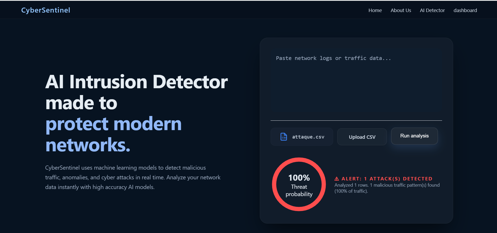
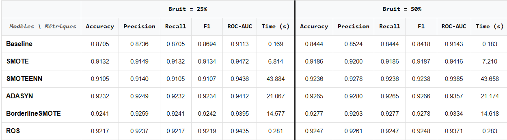

# 🛡️ Network Intrusion Detection Web Application

Application web développée avec **Django** et **Machine Learning**, réalisée dans le cadre de mon **projet de soutenance de Bachelor** (*Analytique des Données et Informatique Décisionnelle* — EST Oujda).

Ce projet associe une **étude comparative des techniques de rééquilibrage des classes** sur des données de trafic réseau déséquilibrées à une **interface web interactive** permettant d'analyser et de détecter les intrusions en temps réel.

---

## 🎯 Objectifs du projet
* **Analyser l'impact du déséquilibre des classes** sur les performances de détection des attaques réseau.
* **Comparer différentes approches de rééquilibrage** (échantillonnage et pondération) afin d'améliorer la détection des attaques minoritaires sans dégrader la précision globale.
* **Déployer le modèle retenu** (`Logistic Regression` + `StandardScaler`) au sein d'une application web ergonomique et accessible.

---

## 📸 Aperçu de l'application et des résultats

### Interface de détection des intrusions


### Résultats et étude comparative


---

## 🛠️ Technologies utilisées
* **Backend & Web :** Python, Django, HTML5, CSS3, JavaScript
* **Data Science & Machine Learning :** Scikit-learn, Pandas, NumPy, Joblib/Pickle

---

## 📂 Structure du projet
```text
network-intrusion-detection-web/
├── detector/               # Application Django (vues, templates HTML, CSS, prédiction)
├── intrusion_project/      # Configuration principale du projet Django
├── screenshots/            # Captures d'écran de l'interface et des résultats
├── logistic_model.pkl      # Modèle de classification entraîné
├── scaler.pkl              # Normaliseur des caractéristiques réseau
├── check_model.py          # Script de vérification du modèle
├── manage.py               # Utilitaire d'administration Django
└── requirements.txt        # Dépendances Python du projet
```

---

## 🚀 Installation et exécution en local

1. **Cloner le dépôt :**
   ```bash
   git clone https://github.com/alae-web/network-intrusion-detection-web.git
   cd network-intrusion-detection-web
   ```

2. **Installer les dépendances :**
   ```bash
   pip install -r requirements.txt
   ```

3. **Appliquer les migrations et lancer le serveur :**
   ```bash
   python manage.py migrate
   python manage.py runserver
   ```

4. **Ouvrir dans le navigateur :** `http://127.0.0.1:8000`

---

## 👩‍💻 Auteure
**Alae Haida** — Étudiante en 4e année du cycle ingénieur en *Génie des Systèmes Informatiques* à **SUPMTI Oujda**.
